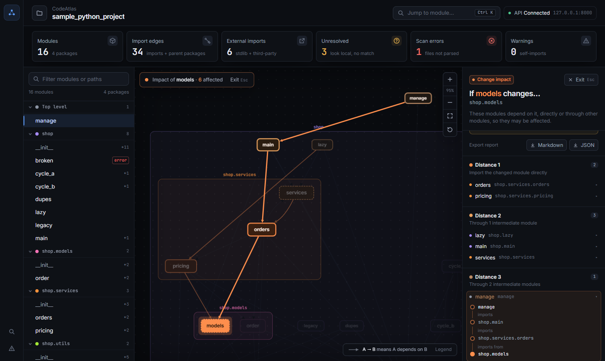

# CodeAtlas

[](https://github.com/Bhanoday777/CodeAtlas/actions/workflows/ci.yml)

CodeAtlas maps the module dependencies of a Python repository and answers one question:
**if this module changes, which other modules may be affected, and why?** It parses the source
statically (analyzed code is never executed), builds a dependency graph from local imports, and
shows the result in an interactive graph with a change-impact report for any module.



## Features

- **Dependency graph** of every module, grouped into package boxes, laid out so importers sit above
  the modules they import. Node size grows with how many modules import it.
- **Change impact** for any module: every module that depends on it directly or transitively, grouped
  by distance, each with one shortest **explanation path**
  (`manage → shop.main → shop.services.orders → shop.models`).
- **Package-aware:** `import a.b.c` runs `a/__init__.py` and `a/b/__init__.py` first, so the importer
  also depends on those packages. Changing a package's `__init__.py` reaches everything that imports
  anything inside it.
- **Honest caveats:** files that failed to parse and imports that look local but match nothing are
  reported with every impact result, because both can hide dependents.
- **Export** an impact report as Markdown (for a pull request) or JSON (the API response unchanged).
- Module search (`Ctrl+K`), module details with line numbers, and a scan diagnostics drawer.

## Quick start

Requirements: Python 3.13, Node.js 22.12+ or 24+.

```bash
# Backend: API on http://127.0.0.1:8000 (interactive docs at /docs)
cd backend
py -3.13 -m venv .venv                                   # macOS/Linux: python3.13 -m venv .venv
.venv/Scripts/python -m pip install -r requirements.txt  # macOS/Linux: .venv/bin/python
.venv/Scripts/python -m uvicorn app.main:app

# Frontend, in a second terminal: open http://localhost:5173
cd frontend
npm install
npm run dev
```

Use `localhost`, not `127.0.0.1`, for the UI: the API's CORS setting allows only that origin. By default
the API analyzes the bundled fixture, `fixtures/sample_python_project`.

### Analyze your own repository

Set `CODEATLAS_REPO` before starting the API. It is scanned once at startup, so restart the API after
changing it or the files in it. An invalid path stops startup; it never falls back to the fixture.

```bash
CODEATLAS_REPO=/path/to/repo .venv/Scripts/python -m uvicorn app.main:app   # PowerShell: $env:CODEATLAS_REPO="C:\path\to\repo"
```

Point it at the **import root**: the folder your top-level packages live in. For a `src/` layout
(`src/requests/...`), that is the `src` folder.

Without the UI, from `backend/`:

```bash
.venv/Scripts/python -m app.parser /path/to/repo                    # modules, edges, external/unresolved imports, errors
.venv/Scripts/python -m app.graph /path/to/repo some.module         # change-impact report
```

## How it works

```text
discovery ──> extraction ──> resolution ──> dependency graph ──> FastAPI ──> React UI
 .py files     ast imports    local /         edges A → B          JSON       Cytoscape graph,
 → module IDs  (never run)    external /      + reverse BFS        API        impact report
                              unresolved      for impact
```

| Stage | Code | What it does |
|---|---|---|
| Discovery | `backend/app/parser/discovery.py` | Finds `.py` files (skipping virtualenvs, `.git`, `node_modules`, …) and assigns dotted module IDs. |
| Extraction | `backend/app/parser/extractor.py` | Reads every `import` / `from … import` with `ast`, including ones inside functions and `try` blocks. |
| Resolution | `backend/app/parser/resolver.py` | Resolves absolute and relative imports to local modules; the rest are external or unresolved. |
| Graph | `backend/app/graph/dependency_graph.py` | Edge **A → B means A depends on B**: A imports B, or a module inside package B. Impact is a breadth-first search over the reverse edges: an O(V + E) search per query, safe on cycles, with deterministic paths. |
| API | `backend/app/api/` | Scans once at startup and serves the graph, module details, impact reports and diagnostics. See [docs/api.md](docs/api.md). |
| UI | `frontend/src/` | React 19 + TypeScript, Tailwind CSS, Cytoscape.js with the dagre layout. See [docs/ui.md](docs/ui.md). |

## Results

Measured on Windows 11 with Python 3.13.5 and Node 24.12.0, in the final test run.

| Repository | Modules | Edges | Largest impact | Checked |
|---|---:|---:|---:|---|
| Fixture (`fixtures/sample_python_project`) | 16 | 34 | 11 | Every module, edge and impact set written by hand in the tests |
| Click 8.5.0 (installed package) | 17 | 76 | 16 | All endpoints self-consistent; every impact report equals an independent BFS (0.45 s) |
| requests (`src/`, commit `611c616`) | 19 | 88 | 16 | Same checks, run on a local clone (0.17 s) |
| Generated repository | 2,021 | 7,611 | – | Exact edge set; impact of all 2,021 modules matches an independent BFS |

On the generated repository, the warm scan took 0.50 s, the impact reports of all 2,021 modules 5.77 s,
and `GET /api/graph` 0.04 s. The first (cold) scan took 7.73 s, dominated by the operating system's
first read of 2,021 new files.

## Testing

```bash
backend/.venv/Scripts/python scripts/check_all.py   # every check below, one pass/fail summary (--skip-e2e to skip the browser)
```

| Suite | Count | Command |
|---|---:|---|
| Backend: parser, graph, API, contract, integration, scale | 271 passed, 1 expected failure, 1 skipped | `cd backend && .venv/Scripts/python -m pytest` |
| Frontend: API client and guards, graph conversion, impact, export, contract | 94 | `cd frontend && npm test` |
| Browser end-to-end (Chrome against the real backend) | 18 | `cd frontend && npm run test:e2e` |

The expected failure documents a known limitation (namespace-package imports); the skipped test
needs `CODEATLAS_REAL_REPOS` (extra repositories to check). The backend and the frontend test against
the same committed API snapshots in `contract/fixture/`, so a field changed on one side fails a test on
the other. GitHub Actions runs all three suites on every push to `main` and on pull requests.
Details, including how each result was cross-checked: [docs/testing.md](docs/testing.md).

## Limitations

Impact results are a static estimate from import statements, not a guarantee of runtime behavior.

- Dynamic imports (`importlib.import_module`, `__import__`) and `sys.path` changes are not seen.
- Imports under `if TYPE_CHECKING:` count as dependencies, and package edges are conservative (a change
  to a package's `__init__.py` is reported as affecting every module that imports anything inside it).
  Together with an `__init__.py` that imports its own submodules, both create cycles that overstate
  impact: in Click 16 of 17 modules, and in requests 18 of 19, appear to affect 15 or 16 others.
- `from X import name` is assumed to refer to a name defined in `X`; the name itself is not verified.
- `import nspkg` of a namespace package (no `__init__.py`) is reported as unresolved; its submodules resolve.
- A local package with the same top-level name as an installed one is treated as local.
- The repository is shown by its folder name, so scanning `requests/src` shows as `src`.

## License

[MIT](LICENSE)
